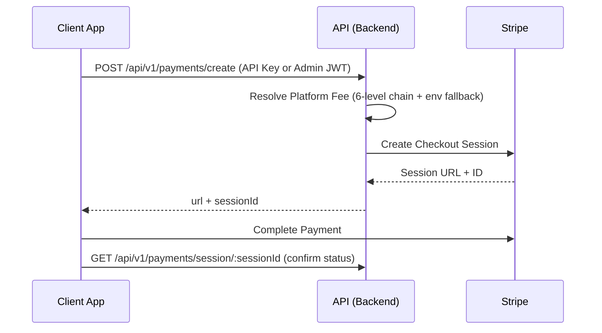
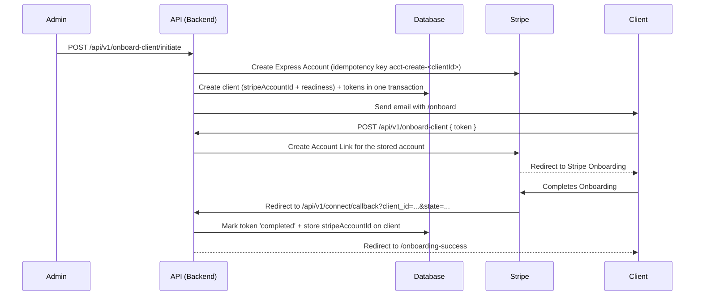

# System Architecture - DFWSC Payment Portal

This document outlines the architectural design and technical foundations of the DFWSC Payment Portal.

## 1. High-Level Overview
The DFWSC Payment Portal is a platform for DFW Software Consulting to manage client payments via **Stripe Connect**. It allows admins to onboard clients into Stripe Express accounts, process one-time payments, and manage client billing configuration. The same app also serves as the DFWSC public-facing marketing site (home, pricing, team, privacy, all prerendered at build time). `/docs` is not a page in this app: nginx redirects it (301) to the developer integration guide on Nextcloud.

## 2. Tech Stack
- **Frontend:** React 18, Vite 8, React Router 7, TanStack Query v5, TailwindCSS v4, three.js (Home and Team scenes only).
- **Backend:** Node.js >=22.12, Fastify 5, TypeScript.
- **Database:** PostgreSQL 17, Drizzle ORM. Redis is optional (rate limiting, used when `REDIS_URL` is set).
- **Integrations:** see section 4.
- **Environment:** Docker (multi-stage builds), nginx (serves the built frontend and proxies `/api/` to the API).

## 3. Specialized Documentation
- [BACKEND.md](./BACKEND.md) — API, Auth, Flows, and Logic.
- [DATABASE.md](./DATABASE.md) — Schema, Drizzle, and Migrations.
- [STRIPE.md](./STRIPE.md) — Connect, Webhooks, and Payments.
- [STYLES.md](./STYLES.md) — Tailwind v4, Theme, and UI Patterns.
- [FRONTEND.md](./FRONTEND.md) — React, routing, prerendering, SEO.
- [ENVIRONMENT.md](./ENVIRONMENT.md) — Every env var and feature flag.
- [DEVELOPMENT.md](./DEVELOPMENT.md) — Git hooks, CI, CLAUDE.md mirrors.
- [BACKUP.md](./BACKUP.md) — Database backups and restore.
- [COOLIFY_DEPLOYMENT.md](./COOLIFY_DEPLOYMENT.md) — Production deployment on Coolify.
- [API_DOCS.md](../API_DOCS.md) — API reference for integrators.
- [CLIENT_INTEGRATION.md](../CLIENT_INTEGRATION.md) — Integrator guide: payments and invoicing.

## 4. Integrations
Everything except Stripe, SMTP and Nextcloud admin login is off unless its flag is set to exactly `true`. A misconfigured job is logged and stays off; it never stops the API from serving. Flag details, required config and defaults: [ENVIRONMENT.md](./ENVIRONMENT.md). Job behavior: [BACKEND.md](./BACKEND.md) sections 9-16.

| Integration | Gate |
|-------------|------|
| Stripe Connect (Express accounts, Checkout, webhooks) | Always on |
| SMTP email (onboarding, API key regeneration, contact form) | Always on |
| Nextcloud admin login (`POST /auth/login`) | Always on; needs `NEXTCLOUD_*` and `ADMIN_NEXTCLOUD_GROUPS` |
| Redis rate limiting | `REDIS_URL` set |
| New Lead automation | `SALES_AUTOMATION_ENABLED` |
| Client onboarding automation | `CLIENT_ONBOARDING_ENABLED` (billing Customer creation: `CLIENT_ONBOARDING_BILLING_CUSTOMER`) |
| Contact card to billing Customer sync | `CONTACT_STRIPE_SYNC` |
| Portal accounts mirror, client billing mirror | `PORTAL_MIRROR`, `BILLING_MIRROR` |
| New Invoice form (billing requests) | `BILLING_REQUESTS_ENABLED` |
| Stripe ID write-back | `STRIPE_ID_WRITEBACK` |
| Billing webhook (`/webhooks/stripe-billing`) | Secret `STRIPE_BILLING_WEBHOOK_SECRET` |
| Connected-account invoicing routes | `CONNECT_INVOICING` |
| Cerebo workspace API | `CEREBO_ENABLED` |

## 5. Key Architectural Flows

### Payment Flow (Stripe Connect)

### Onboarding Flow

### Connected-account invoicing (optional)
Behind `CONNECT_INVOICING` and a per-client `invoicing_enabled` flag, an API-key client can invoice its own customers. The API makes direct Stripe calls on the client's connected account (customers, draft invoices, finalize, send, void, delete); Stripe emails the invoice and the customer pays on its hosted page. Postgres keeps ids, amounts and idempotency records (`connect_customers`, `connect_invoices`, `connect_invoice_sends`), and the Connect webhook plus a stale re-check on read keep statuses current. See [BACKEND.md](./BACKEND.md), [STRIPE.md](./STRIPE.md) and the integrator guide [CLIENT_INTEGRATION.md](../CLIENT_INTEGRATION.md).

## 6. Data Model (Drizzle/PostgreSQL)
This is a summary. Column-level detail, authoritative vs derived tables and migrations are in [DATABASE.md](./DATABASE.md).

- **`clients`**: Primary entity. `workspace` is always `"client_portal"`. `status` is `active`, `inactive`, `pending`, `failed`, or `archived`.
- **`client_groups`**: Shared fee/URL configuration for multiple clients.
- **`onboarding_tokens`**: Lifecycle management for Stripe Connect onboarding. Statuses: `pending`, `in_progress`, `completed`, `revoked`.
- **`webhook_events`**: Idempotency log for Stripe webhooks.
- **`payment_ledger`**: Record of each Checkout payment created through the API, keyed per client by idempotency key.
- **`api_key_regeneration_tokens`**: Single-use, 15-minute tokens emailed for API key regeneration.
- **`billing_customers`**, **`billing_snapshots`**, **`billing_request_submissions`**, **`billing_request_sync_state`**: Billing Customers and New Invoice form state.
- **`contact_stripe_sync_books`** / **`contact_stripe_sync_cards`**, **`portal_mirror_rows`** / **`portal_mirror_state`**, **`stripe_id_writebacks`**: State for the contact sync, Nextcloud mirrors and Stripe ID write-back.
- **`connect_customers`**, **`connect_invoices`**, **`connect_invoice_sends`**: Connected-account invoicing (see above).
- **Cerebo tables** (`src/cerebo/schema.ts`): created by the normal migrations whether or not `CEREBO_ENABLED` is set.
- **`admins`**: Legacy, no longer used (admin login is checked against Nextcloud); to be dropped.
- **`settings`**: Key-value store for system-wide configuration (e.g., `company_name`).
- **`sales_lead_submissions`** / **`sales_lead_sync_state`**: Progress and baseline of the Nextcloud New Lead automation (off unless `SALES_AUTOMATION_ENABLED=true`; see [BACKEND.md](./BACKEND.md) §9).
- **`client_onboarding_submissions`** / **`client_onboarding_sync_state`**: Progress and baseline of the Nextcloud client onboarding (off unless `CLIENT_ONBOARDING_ENABLED=true`; see [BACKEND.md](./BACKEND.md) §10).

## 7. Security & Authentication
- **Admin Access:** JWT Bearer token obtained from `POST /api/v1/auth/login`.
- **Client Access:** `X-Api-Key` header — `apiKeyLookup` (SHA256) for fast DB lookup + `apiKeyHash` (bcrypt) for verification.
- **CSRF Protection:** State-based validation for Connect callbacks (32-byte random token, 24-hour expiry from `OAUTH_STATE_EXPIRY_MS`, single use, bound to the client id).
- **Rate Limiting:** Redis-backed sliding window per IP (checkout creation uses a token bucket per Stripe account) when `REDIS_URL` is set; otherwise falls back to per-process in-memory buckets (logs a one-time startup warning, since limits are then multiplied by replica count under horizontal scaling). Proxy trust, client IP resolution and the limits per route are in [BACKEND.md](./BACKEND.md) section 4.

## 8. Architectural Rules
- **Layered Architecture:**
  - **Routes (`src/routes/`)**: Controller layer — HTTP validation and response shaping.
  - **Lib (`src/lib/`)**: Service layer — business logic, Stripe integrations, utilities.
  - **DB (`src/db/`)**: Data layer — PostgreSQL schema via Drizzle ORM.
- **Cerebo (`src/cerebo/`)**: Client/project workspace API with its own routes, schema and services, registered under `/api/v1/cerebo` only when `CEREBO_ENABLED=true`. Admin JWT only.
- **Background jobs**: The Nextcloud and Stripe sync jobs (`src/lib/*-sync.ts`) are started from `src/index.ts` after the server is listening and stopped on shutdown. Each polls on an interval and runs through a coalesced runner, so overlapping triggers collapse into one cycle. Write sites (the webhook handlers, the clients, groups, connect and payments routes, and some library modules) call `kickJob(name)` (`src/lib/coalesced-runner.ts`) to start a cycle of the portal mirror, billing mirror, sales lead or Stripe ID write-back job right away; it is a no-op when the job is off. Processed `webhook_events` are pruned at boot and then on a recurring sweep.

## 9. Styling & UI Patterns
The project uses a dual light/dark theme with a blue brand accent. Token tables and usage rules are in [STYLES.md](./STYLES.md).

- **Framework:** TailwindCSS v4 (`@import "tailwindcss"` + `@theme` block in `index.css`).
- **Theming:** CSS custom properties on `:root` (light) and `.dark` — `--bg-main`, `--bg-surface`, `--text-main`, `--text-muted`, `--glass-bg`, `--glass-border`.
- **Brand Colors:** `brand-50` through `brand-700` (primary: `brand-500` = `#2c6daf`; page background `#f8f7f3` light, `#0b1322` dark).
- **Glassmorphism:** `.glass` and `.glass-dark` utility classes for blurred translucent surfaces.

## 10. Development & Tooling
- **Linting/Formatting:** Biome.
- **Testing:** Vitest (backend integration tests); React Testing Library (frontend).
- **Migrations:** Drizzle-kit (`npm run db:generate` / `npm run db:migrate`).
- **Swagger:** Enabled when `ENABLE_SWAGGER` is exactly `true` in any environment. The Swagger packages are regular dependencies (also installed by `npm ci --omit=dev`) and no code guards production, so only the env value controls it. UI at `/docs` on the API. `docker-compose.base.yml` hard-codes `ENABLE_SWAGGER: 'false'`, so it is off in the Docker stacks. On the public site, nginx redirects `/docs` to Nextcloud instead.

## 11. Deployment topology
- **Frontend:** a separate nginx container built from `front/Dockerfile`; it serves the prerendered site and proxies `/api/` to `dfwsc-api:4242`.
- **API:** `docker-compose.prod.yml` runs `migrator` (migrations, then exits), `api`, `dfwsc-redis` and `backup`. `api` joins the external `coolify` network with the alias `dfwsc-api`. There is no web container in this compose file.
- **Not provable from this repository:** the proxy chain in front of the containers and the deploy trigger. Those are described, and marked as owner-confirmed, in [COOLIFY_DEPLOYMENT.md](./COOLIFY_DEPLOYMENT.md).
